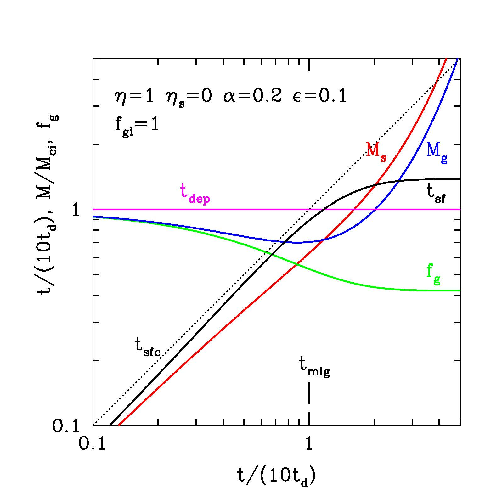
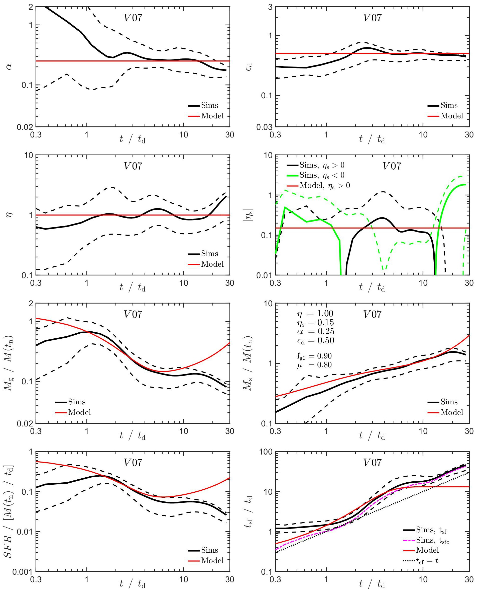
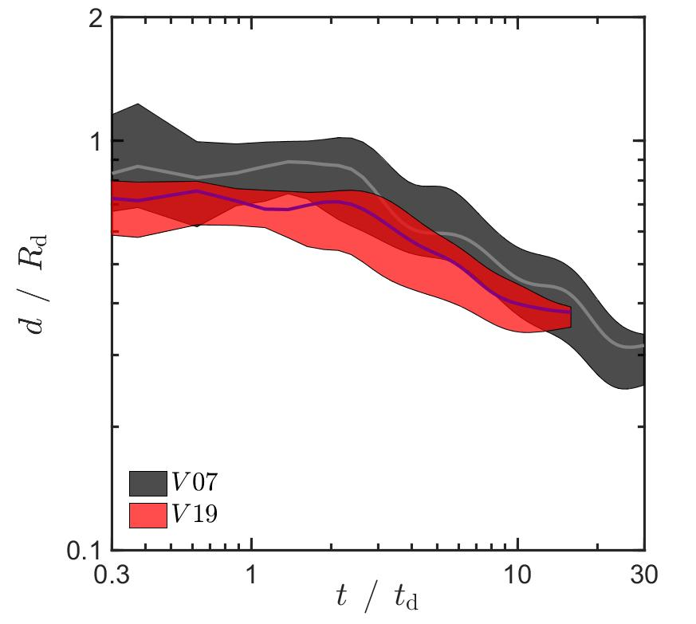
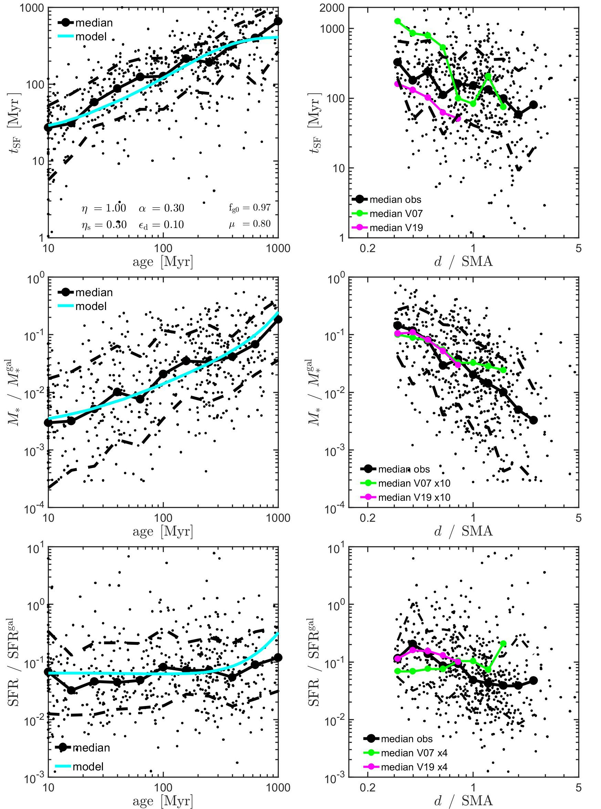

# Clump Evolution: An Analytic "Bathtub" Model vs. High-Cadence Tracking

**Two coupled ordinary differential equations at the heart of a model for how 
giant clumps live and die, validated against hundreds of tracked clump histories 
from simulations, both cosmological and idealized, and against Hubble Space Telescope 
observations.**

This project is the modeling layer built on top of the
[clump finder & tracker](../Galaxy_Catalogues_and_Clump_Finder/). Having
detected and tracked thousands of clumps, the question became whether their
life cycle could be captured by a simple, predictive analytic model. The
result is published in
[Dekel, Mandelker, Bournaud et al. 2022, MNRAS 511, 316](https://arxiv.org/abs/2107.13561).

## The problem

Whether giant clumps survive long enough to migrate to their galaxy's center, 
or are destroyed within a few tens of millions of years by energetic feedback 
from their own star-formation, was a decade-long debate with different simulation 
codes giving different answers depending on their feedback physics. What was 
missing was a *transparent* and *flexible* model, where each physical process is a term 
you can tune up or down, so you can see exactly what drives survival or disruption, 
rather than another expensive and 'black-box' simulation.

## The model

A clump is treated as a "bathtub", with its gas and stellar mass evolving
together (`analysis/clump_evolution_exact.m`). Two coupled equations, eight
lines of code:

- **Gas** is accreted from the surrounding disc (rate parameter α), converted
  into stars (efficiency ε per free-fall time, retention rate μ), and expelled
  by stellar-feedback outflows (mass-loading factor η).
- **Stars** form out of that gas and are removed by tidal stripping (η_s). 
  As a modelling convenience, the latter is written as a mass-loading factor 
  tied to the star-formation rate so that it parallels the gas outflow term.

The two are coupled in both directions: accretion feeds off the total baryonic
mass, so stars drive gas growth, while every stellar term is set by the gas.

Migration is prescribed rather than solved. The clump's distance from the disc
centre shrinks over an analytically derived migration timescale, `t_mig`, which
is an input to the model rather than an output of it. Carrying it alongside the
two mass equations is what fixes the moment the clump reaches the centre, where
the solution is reported.

`fig_clump_bathtub.m` integrates the system to produce the model-solution
curves (the figure below), sweeping the outflow mass-loading η and comparing
two stripping cases (η_s = 0 and η_s = μ).

Also included is `clump_evolution_exact2.m`, an exploration that did not go
into the paper as-is. It runs the same sweep over the outflow mass-loading η,
integrating to the moment the clump reaches the disc centre and recording the
final-to-initial ratios of gas mass, stellar mass, total mass, gas fraction,
and the elapsed migration time. It then plots the full time evolution for one
chosen η. Note that because the migration rate scales with the clump's mass, 
a clump that grows arrives early and a stripped one arrives late, so the actual 
travel time departs from the nominal `t_mig` by an amount that depends on the 
feedback strength.


*Model solution for one parameter choice: clump gas mass, stellar mass, gas
fraction, and radius as functions of time since clump formation. Each curve
responds transparently to the accretion, star-formation, outflow, and
migration parameters. From Dekel, Mandelker et al. 2022, Fig. 1.*

## The test against simulations

The model's inputs and predictions were confronted with high time-resolution 
clump tracking produced by the "thin-timesteps" 
[pipeline in this repository](../Galaxy_Catalogues_and_Clump_Finder/src/thin_timesteps/). 
This was applied to two cosmological simulations (VELA 07 and 19, aka V07 and V19) 
and, with a lightly adapted input stage, to isolated-galaxy RAMSES simulations run 
with and without radiation-pressure feedback (by F. Bournaud's group).

The heavy lifting of the analysis is in `prop_vs_t_over_tdyn_rectangle.m` 
(~1,400 lines of code, an amusing contrast with the 8-line model it tests, 
and called by the `launch_prop_vs_t_over_tdyn.m` driver). This applies sample 
cuts to the tracked clump histories, aligns them by time since clump formation, 
stacks them (mean or median, with scatter) into average evolution tracks, smooths 
over noisy data, and finally integrates the analytic model inside the plotting 
routine to overlay the model curves on the stacked simulation tracks. This 
produced the paper's simulation-vs-model figure panels. The other `launch_*` 
drivers and their analysis functions (`specific_rates.m`,
`clump_property_histograms.m`) produced the supporting property and rate
comparisons. Crucially, the specific rates the model treats as free parameters 
(gas accretion, star formation, gas outflow, stellar stripping) were also 
*measured directly* from the simulations, and the model was plotted with those 
measured values. So, up to the unavoidable measurement choices (interpolation, 
smoothing, error estimation), the comparison has no hand-tuned knobs.


*The central comparison, for 37 massive and unique tracked clumps in galaxy VELA 07. 
The top four panels show the model's rate parameters: accretion α, star-formation efficiency 
ε_d, and the gas and stellar outflow mass-loadings η, η_s. These are measured directly 
from the stacked simulation histories and shown in black, with scatter. The red lines 
are the constant values adopted by the model. The bottom four panels show the resulting 
evolution of gas mass, stellar mass, SFR, and star-formation time. The simulation stacks 
are shown in black, and the analytic model in red. From Dekel, Mandelker et al. 2022, Fig. 6.*


*Tracked clumps migrate inward: median galactocentric distance vs. time
since formation for the clumps in the two cosmological simulations, in units
of the disc radius and disc dynamical time. From Dekel, Mandelker et al.
2022, Fig. 9.*

## The test against observations

`read_Guo2.m` ingests the observed clump catalog of Guo et al. (HST/CANDELS
galaxies), applies selection cuts consistent with the simulation analysis,
and compares the observed trends of clump properties with stellar age and
galactocentric distance against the model predictions. The model matches
the observed gradients of star-forming clumps.


*The observational test: each dot is an observed clump from the HST/CANDELS
catalog of Guo et al. Left column: star-formation time, clump stellar mass,
and SFR against clump stellar age, with the analytic model in cyan (its
parameters listed in the top panel). Right column: the same properties
against galactocentric distance, with the median trends of the simulated
clumps (V07, V19) overlaid on the observed medians. From Dekel, Mandelker
et al. 2022, Fig. 10.*

## Results, briefly

Massive clumps (above ~10⁸ solar masses) are wounded but not killed by
feedback: they either lose gas continuously yet survive or they 
net grow in mass by accretion from the background disc. Either way, they 
migrate to the galaxy center within a few disc dynamical times. Low-mass 
clumps, on the other hand, disrupt due to catastrophic mass loss on a clump 
dynamical time. The same dichotomy was found statistically in Mandelker 
et al. 2017 (long-lived and migrating vs. short-lived and disrupted), 
but now sharpened from a classification into a quantitative evolution 
model where the dependence on feedback strength is clear and transparent.

## Contents

```
├── README.md            ← this file
├── analysis/            ← MATLAB: the analytic model (clump_evolution_exact*.m),
│                           simulation stacking (launch_* + their analysis
│                           functions), catalog loading
│                           (load_data.m, load_gen3.m, add_properties.m), and
│                           the observational comparison (read_Guo2.m)
└── figures/             ← publication figures (from my own papers, cited)
```

The Fortran tracking code this project consumes is published in the
[clump finder project](../Galaxy_Catalogues_and_Clump_Finder/); the RAMSES
input variant differed only in its reader. Catalog data files are not
included (see the clump finder's `sample_output/` for the format).
