# Cosmic Web Refinement: Spending Resolution Where the Physics Is

**Adaptive-refinement methods that raised effective resolution by up to ~100x 
in the diffuse regions every previous simulation had left under-resolved, for 
~5x the compute, plus the Python analysis that showed what the new resolution 
revealed and the numerical validation that kept the results honest.**

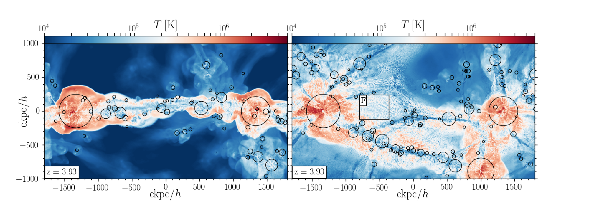
*Gas temperature at z~4 (~12 billion years ago), viewed edge-on (left) and 
face-on (right) with respect to an intergalactic sheet of the cosmic web roughly 
10 million light-years across. Circles mark galaxy halos. The sheet has collapsed 
and shock-heated itself to over a million degrees (red), while cold gas (blue) is 
concentrated into filaments and a fog of small clouds. This multiphase state, in 
the gas between the halos and far outside any of them, is the **intra-pancake medium (IPM)**, 
and it is what standard simulations cannot resolve. From Mandelker et al. 2021, Fig. 2.*

## The problem

Cosmological simulations divide a volume into resolution elements and follow
them as the universe evolves. Because the interesting objects (galaxies) are
dense, essentially every code allocates resolution by **mass**: an element
covers a fixed amount of matter, so dense regions get small elements and
diffuse regions get large ones.

That choice is efficient and, for galaxies, correct. It also guarantees that
the ~99% of the volume that is *not* a galaxy is resolved poorly, by elements
sometimes hundreds of times larger than the structures inside them. For a long
time this was assumed to be harmless, on the grounds that diffuse gas is
smooth. The work here established that this assumption is false: the diffuse
gas is not smooth, and simulations were missing real physics because they
could not see it.

The engineering problem is that you cannot fix this by simply running at
higher resolution everywhere. Uniformly resolving the cosmic web at the
required scale is computationally out of reach by orders of magnitude. The
resolution has to be *targeted*.

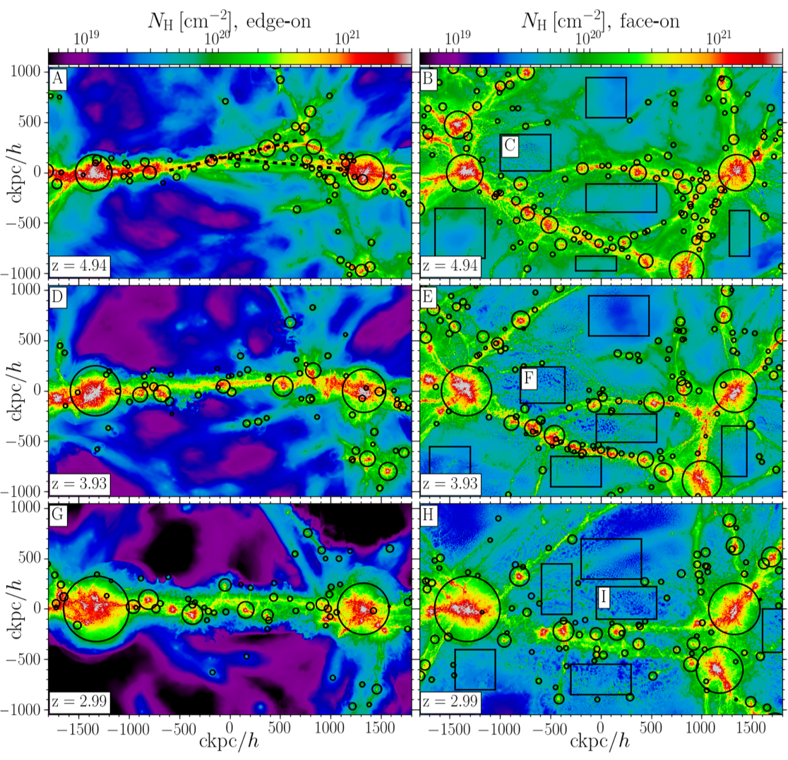
*The system being simulated, in hydrogen column density, edge-on (left) and
face-on (right) with respect to the cosmic sheet, at three epochs, spanning 
roughly 1.5 billion years. Circles mark halos; rectangles mark the regions 
selected for analysis. Two massive halos sit at either end of a vast sheet 
of gas and are fed by cosmic-web filaments. The sheet is seen collapsing in 
the earliest timestep shown (top row), which leads to the shock seen in the 
temperature maps shown above, whose time corresponds to the middle row shown 
here. From Mandelker et al. 2021, Fig. 1.*

## Two refinement methods

Together with my collaborators, I developed two novel refinement methods to 
increase the resolution in diffuse intergalactic gas. One method operated inside 
the dark matter halos surrounding galaxies (the circumgalactic medium) and the other 
inside filaments and sheets of the cosmic web. Both methods supplement the previous 
state of the art with an additional criterion that forces small cells where standard 
refinement would not. Both were built in [AREPO](https://arxiv.org/abs/0901.4107), a 
moving-mesh hydrodynamics code, in collaboration with its author, Volker Springel.

| Method | Target region | Criterion | Result |
|---|---|---|---|
| [van de Voort et al. 2019](https://arxiv.org/abs/1808.04369) | Circumgalactic medium (gas halo around a galaxy) | Refine on **fixed volume** rather than fixed mass: any cell exceeding a target volume is split, regardless of its mass | 82x more resolution elements in the CGM for 8x the compute (1 kpc refinement); 10x for 2x (2 kpc). Later work implemented 0.5 kpc refinement yielding 640x resolution elements for 32x the compute |
| [Mandelker et al. 2019](https://arxiv.org/abs/1906.10693) | Intergalactic cosmic web: sheets and filaments, far outside any halo | Extend targeted refinement beyond halo boundaries, into the intergalactic medium itself, by targeting cosmic web elements on which to 'zoom-in' | First simulations able to resolve gas dynamics in the cosmic web at high fidelity |

The trade-off improves as the refinement gets more aggressive: halving the
target scale roughly doubles the resolution gained per unit of compute, from
~5 elements per unit cost at 2 kpc to ~20 at 0.5 kpc. The headline figure
above is that most aggressive case.

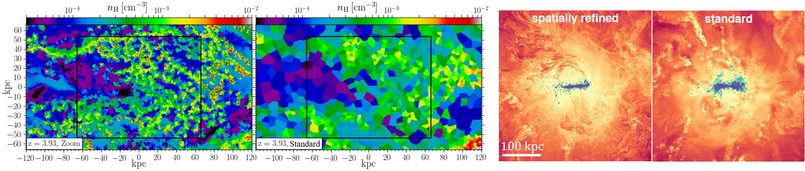
*Both methods, against their unrefined controls. **Left pair:** hydrogen
density in a cosmic sheet at z~3.93, with cosmic-web refinement (left) and at
standard resolution (right); the dense clumps present on the left are entirely
absent on the right. **Right pair:** gas density in a slice around a Milky Way-mass
galaxy with fixed-volume CGM refinement and without, where the refined version 
resolves cold and dense structure and turbulent detail the standard run smooths 
away. From Mandelker et al. 2019, Fig. 4 and van de Voort et al. 2019.*

**Division of labour, stated precisely.** The ideas behind how to proceed were
genuinely collaborative, and I played a large part in both. For van de Voort
et al. 2019 I was a collaborator rather than lead author, heavily involved in
the idea and the analysis, but I did not edit the code. For Mandelker et al.
2019 I led the work and edited the AREPO source myself (written in C), together 
with Volker Springel, who helped with the coding in both cases.

**On adoption.** Several groups implemented similar fixed-volume CGM 
refinement in different codes at around the same time; it was a race, and we
published first. No one has directly reproduced the cosmic-web (IPM) method,
but more recent simulations have added their own fixes to improve cosmic-web
resolution, motivated by the finding, first established here, that it matters.

**The AREPO source is written in C and is not open source, so none of it
appears in this repository, including my own edits.** What follows is the
Python analysis built on top of the simulations it produced.

## What the resolution revealed

Gas in the cosmic web is shock-heated as sheets and filaments collapse. At low
resolution that hot gas stays smooth. At high resolution it becomes thermally
unstable and **shatters** into small, cold, dense cloudlets, a qualitatively
different state that low-resolution simulations do not merely smooth out, but
miss entirely.

The defining property of shattering, in the sense introduced by
[McCourt et al. 2018](https://arxiv.org/abs/1610.01164), is that the fragments
are **volume-filling**: the cold gas is not a few discrete clouds but a mist
dispersed throughout the hot medium. That distinction is what makes the
resolution requirement so severe, and it is what the following figures and
movie are showing.

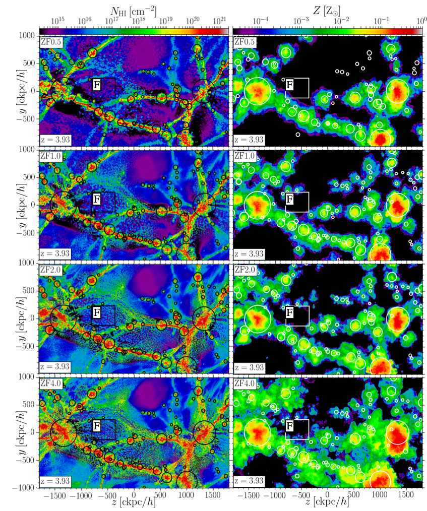
*Four simulations of the same region differing only in refinement, ZF0.5
(top) through ZF4.0 (bottom), in neutral hydrogen column density (left) and
metallicity (right). Spatial (mass) resolution increases by a factor of 2 (8) 
from one row to the next, with the final row being our highest resolution run, 
~10x better than the previous state of the art. Small-scale structure keeps appearing 
as resolution improves, and it appears in gas whose metallicity stays extremely 
low, which is what makes it observationally distinctive. From Mandelker et al. 2021,
Fig. 3.*

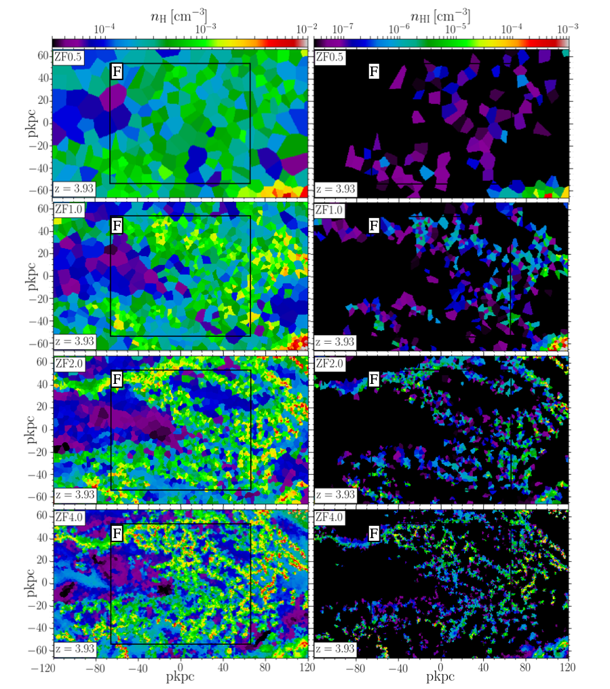
*The same four simulations in an infinitesimally thin slice through the sheet. 
Total hydrogen density on the left, and cold, neutral hydrogen density on the 
right. Rather than converging, the gas keeps fragmenting into smaller and colder
clouds as resolution improves, which is the signature that the physics was
being suppressed by resolution rather than resolved by it. From Mandelker et
al. 2021, Fig. 4.*

This matters observationally because the cloudlets are dense and neutral, and
are therefore candidates for a class of absorption-line systems seen against
background quasars whose very low measured metal content had been difficult to
explain.

### The simulation in motion

The still frames above are single moments and single planes. Two movies show
what neither can: the formation of the hot phase from an accretion shock, the 
later formation of the cold phase in the wake of the shock wave, and that the 
cold phase really does fill the volume.

**[▶ Gas temperature across cosmic time](movies/temperature_movie_large_scale_new.mp4)**
*(mp4)* — the moving version of the figure at the top of this page, viewed
edge-on and face-on. The sheet collapses, a shock sweeps outward across it and
heats the gas to over a million degrees, and cold filaments survive threaded
through the hot medium. The frame is held steady across the whole sequence by
the halo tracking described below, so the structure can be followed rather
than drifting out of view.

**[▶ Density, sweeping through the sheet](movies/density_slices.mp4)** *(mp4)*
— a single moment rather than a sequence: consecutive infinitesimally thin
slices at fixed redshift, travelling perpendicular to the sheet from one face
through to the other. This is the direct evidence that the cloudlets are
volume-filling. A single slice, such as the figure above, invites the
objection that a favourable plane was chosen; sweeping through the whole
thickness shows the mist is pervasive.

The temperature movie and the figure at the top of this page come from
[`analysis/MakeMaps_Temp_Gas.py`](analysis/MakeMaps_Temp_Gas.py), which renders
one frame per snapshot. Two details in it are worth pointing out:

- **A stable frame across cosmic time.** The camera centres on the midpoint
  between the progenitors of the two most massive halos at the final time, 
  read from the tracked-descendant positions in `sample_data/`, with periodic-boundary 
  wrapping applied before the midpoint is taken (a pair straddling the box 
  edge would otherwise place the centre on the opposite side of the volume). 
  Without this the structure drifts out of frame as the simulation evolves.
- **Density weighting done as a ratio of projections.** Temperature is not
  averaged along the line of sight directly. The script projects `rho * T` and
  `rho` separately and divides the two grids, which yields a density-weighted
  temperature rather than one dominated by the large volume of hot, tenuous
  gas that any unweighted average would return. This projection better highlights 
  cold and dense gas, and also better represents observations where temperature is 
  inferred from emission or absorption lines whose strength increases with density.

## The observable, and why it forced the convergence question

The cloudlets matter only if they change something a telescope could measure.
The quantity that connects them to data is the **covering fraction**: looking
through the sheet along many lines of sight, what fraction of the sky shows
neutral hydrogen above a given column density? That is exactly what surveys of
quasar absorption systems measure.

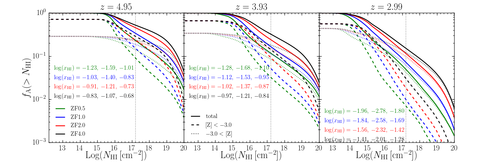
*Covering fraction of absorption systems against neutral hydrogen column
density, at z~5, 4, and 3. Solid lines are all absorbers; dashed and dotted
split them into low and high metallicity at [Z] = -3.0. Colours are the four
resolutions. The curves do not converge at any redshift in either metallicity
bin, and the low-metallicity absorbers are the worse offenders: the covering
fraction of low-metallicity Lyman Limit Systems in the highest-resolution run
is ~30%, 15% and 3% at the three redshifts, against ~9%, 3% and 0.7% in the
lowest. From Mandelker et al. 2021, Fig. 6.*

This is the figure that made the convergence study necessary. A factor of
three to four in a directly observable quantity, still moving at the highest
resolution available, is not a measurement.

[`analysis/NHI_covering_fractions_sheet_projected_metallicity_bins_convergence.py`](analysis/NHI_covering_fractions_sheet_projected_metallicity_bins_convergence.py)
produces it, and it is the most observation-facing code in the project: it
forward-models the simulation into the quantity an observer reports, rather
than reporting an internal simulation variable. Two design decisions in it are
worth pointing out:

- **The comparison is held fixed across the arms.** Splitting absorbers by
  metallicity is the crux of the result, but each simulation has its own
  metallicity distribution, so letting each one define its own bins would move
  the goalposts between resolutions. Instead the bin boundaries are taken from
  a single reference run (`Z_from_ZF1`) and applied to all of them, so every
  resolution is compared over the same regions. The loop is reordered to put
  that reference simulation first so its distribution is available to the
  others.
- **A fixed pixel scale, decoupled from the simulation resolution.** The maps
  are built at 2 comoving kpc/h regardless of how finely the underlying run is
  resolved. Without this the "convergence" test would partly be measuring the
  map resolution rather than the physics.

## The convergence criterion: knowing when to stop

A result that keeps changing as you add resolution is not yet a result. In 
[Mandelker et al. 2019](https://arxiv.org/abs/1906.10693), where we first 
introduced these simulations, this was the case. The follow-up study, 
[Mandelker et al. 2021](https://arxiv.org/abs/2107.03395), asked the 
question directly: what resolution is *enough*, and how would we know?

The answer required identifying the mechanism, not just documenting the
non-convergence. In low-resolution simulations, gas in the shocked sheet 
piles up at intermediate temperatures (~10^4.6 to 10^5 K) instead of cooling 
through them. The hypothesis was a **cooling bottleneck**: cells in that 
range cannot cool because the physical length over which cooling operates 
is smaller than the cell itself, so the simulation cannot represent the process.

The pile-up is visible directly in the distribution of gas over density and
temperature.

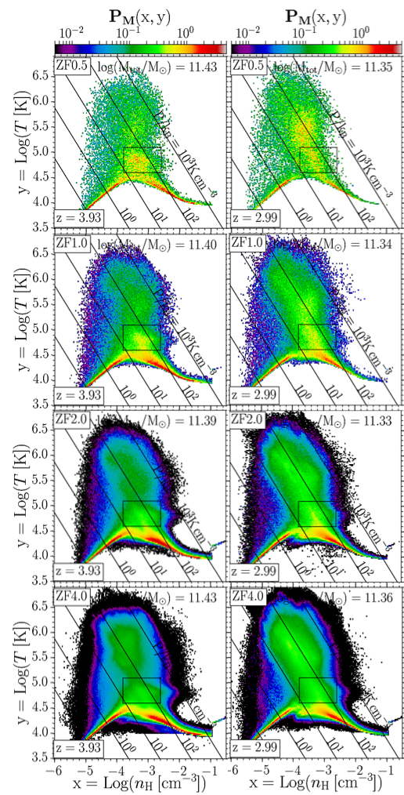
*Where the gas sits in density-temperature space, for low-metallicity gas at
z~4 (left) and z~3 (right), with halos removed. Rows are the four resolutions,
ZF0.5 at the top to ZF4.0 at the bottom; colour is the fraction of gas mass in
each bin; diagonal lines are constant thermal pressure. The total gas mass is
converged across all four, so the differences are in how that mass is
distributed, not how much there is. At low resolution the gas bunches at
intermediate temperatures; at high resolution it separates into distinct cold
and hot phases. From Mandelker et al. 2021, Fig. 9.*

The temperature-density box that the tracking analysis below selects from was
read off these diagrams.

Testing the bottleneck meant following individual parcels of gas through time.

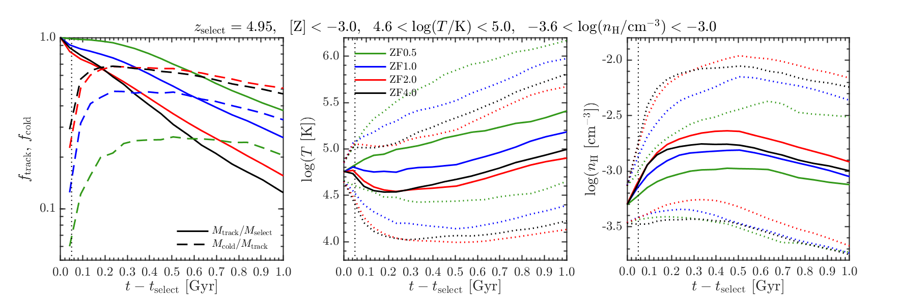
*Gas cells selected at z~5 inside the temperature-density box where the
pile-up occurs, then tracked forward. **Left:** the fraction of the originally
selected mass still trackable (solid) and the fraction that has cooled below
10^4.5 K (dashed). **Centre and right:** the mean and spread of temperature and
density. The initial distributions are matched across resolutions, so
divergence in the evolution is not a selection effect. Gas cools faster 
and more efficiently at higher resolution. From Mandelker et al. 2021, Fig. 13.*

This is the analysis in
[`analysis/gas_temperature_histories_from_nT_overdensity.py`](analysis/gas_temperature_histories_from_nT_overdensity.py),
and it is the most transferable piece of code in this project. Two things make
it harder than it looks:

**Tracking a cohort through a system with no persistent entities.** On a
moving mesh, cells are continuously refined and derefined; a cell is not a
lasting object with a stable identity. Gas is followed by cell ID until the
cell is refined or derefined, at which point that parcel drops out of the
sample. The consequence is deliberate and visible in the figure: the left
panel is a **survival curve for the tracked sample**. Rather than reporting
statistics over a silently shrinking population, the attrition is measured and
published alongside the result.

**Layered, switchable exclusion.** The scientific question concerns gas *not*
associated with galaxies, so galaxy-associated material has to be removed. The
script exposes this as a single `exclude` parameter selecting among several
definitions (cells in bound groups, in subhalos, within a virial radius, or
excluded in projection), each with its own mass or particle-count threshold.
The definitions are not equivalent and the choice affects the answer, so the
sensitivity of results to that choice can be tested rather than assumed.

With the mechanism identified, the criterion follows: **resolve the cooling
length**, the distance sound travels in a cooling time and the largest scale 
that can cool while maintaining pressure equilibrium with its surroundings.

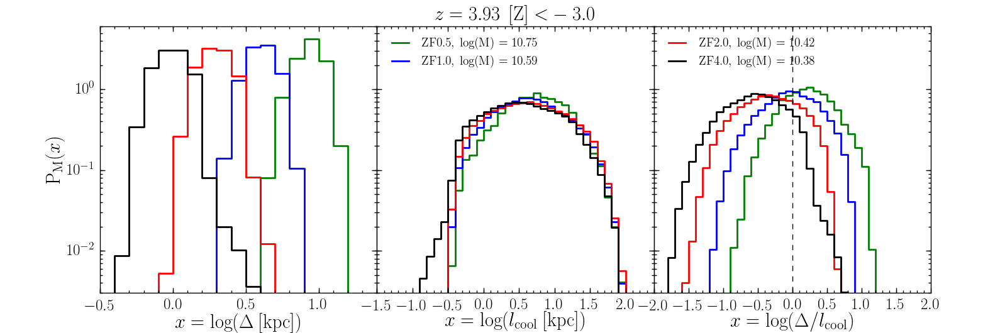
*Distributions of cell size, cooling length, and their ratio, for gas in the
pile-up region. The lower-resolution runs sit on the wrong side of the
criterion. From Mandelker et al. 2021, Fig. 11.*

The criterion itself is two lines of arithmetic (`lcool = tcool * Csound`,
compared against the cell size). It is stated here rather than shown as code,
because the script that produces the figure is 2,159 lines of which roughly
650 are plot formatting, and the substance is entirely in the figure.

## What refinement costs

[`analysis/Ncells_estimate.py`](analysis/Ncells_estimate.py) is the cost model
behind the whole approach: for each snapshot it counts the resolution elements
actually used under mass refinement, then computes what uniform 200 pc and
100 pc resolution would have required across the same volume. It is the 
targeted-versus-uniform trade-off made explicit, and short enough to read in 
full. These estimates were needed for planning the next generation of
simulations, which combine both refinement methods, reaching ZF4.0 resolution
in the cosmic web along with 200 pc resolution in galaxy halos.

## Validation: an interpolation scheme that failed a conservation check

[Lu, Mandelker et al. 2024](https://arxiv.org/abs/2306.03966) analysed the
structure of cosmic-web filaments in these simulations, decomposing the forces
holding a filament together. Doing that requires derivatives and surface
integrals, which require a regular grid, which means interpolating from
AREPO's unstructured Voronoi mesh onto a uniform cylindrical grid.

The natural approach is to deposit each cell's mass, momentum and energy with
a smoothing kernel, as commonly done in smoothed-particle hydrodynamics (SPH) 
simulations. It conserves the totals exactly, which is precisely the property 
you want. However, in this case, this approach failed.

The failure mode was **empty bins**: because the mesh is unstructured and cell
sizes vary widely, a kernel size which scales with cell size, which is the natural 
choice for depositing gas, leaves many grid bins with no gas deposited at all. 
Critically, this got *worse* at finer grid resolution, since smaller bins are 
easier to miss. **That signature was the red flag.** A correct method converges 
as you refine it; a method whose artifacts grow under refinement is not converging 
to anything.

The replacement was deliberately cruder: **zeroth-order nearest-neighbour
assignment**, giving each bin the properties of whichever cell centre is
closest. It does not conserve mass, momentum or energy, but it guarantees
every bin has a well-defined value, and it represents the fluid accurately at
the grid points provided the bins are not much larger than the cell sizes. 
Trading an exact conservation property for a well-posed field was the right 
trade, but it is only defensible if the conservation error is then measured.

Both choices survive in the code as a live switch, in
[`force_decomposition/deposit_to_cylindrical_grid.py`](force_decomposition/deposit_to_cylindrical_grid.py):

```python
h_over_Delta = 0.0 # 1.0  # If this is >0, this is SPH smoothing kernel (radius) in units of
                          # the effective cell size (diameter). IF THIS IS 0, USE NEAREST
                          # NEIGHBOUR GAS CELL INSTEAD OF SPH SMOOTHING
```

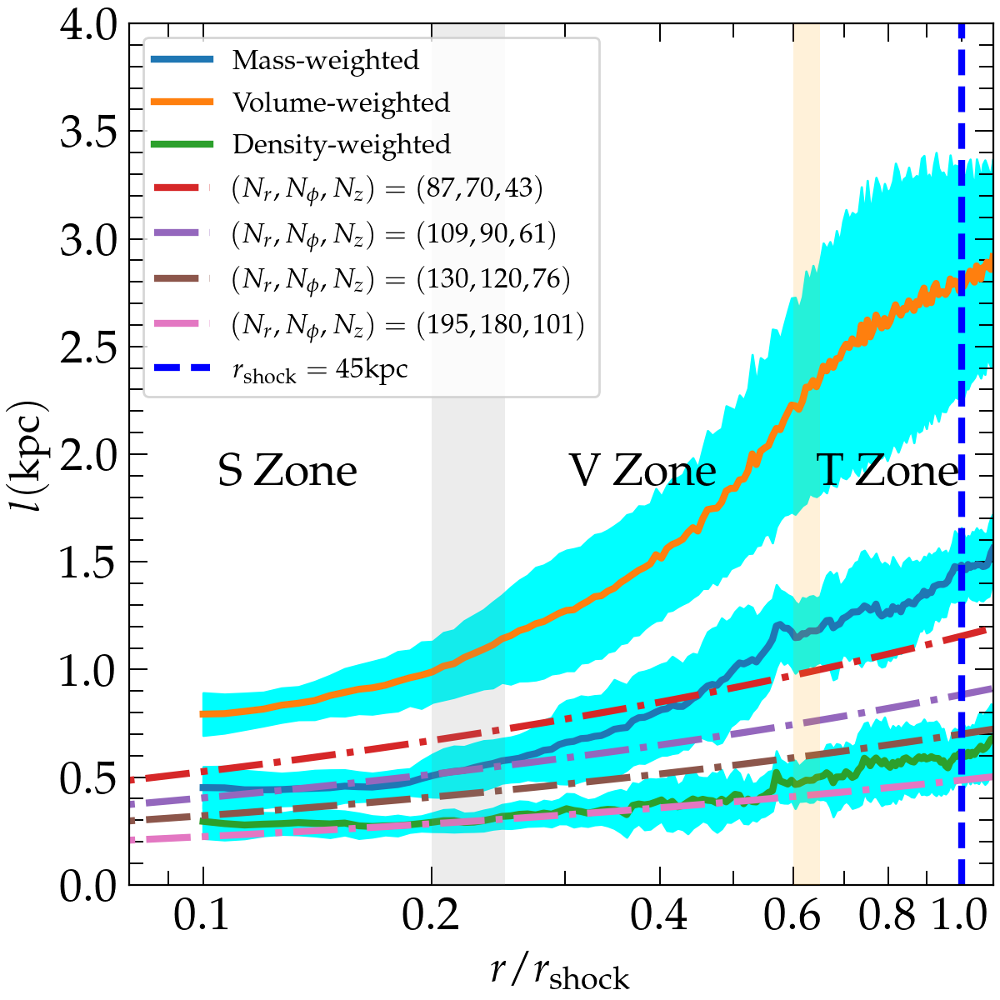
*Matching the grid to the mesh. Solid lines are average cell size against
radius; dot-dashed lines are bin sizes for candidate grids. Bins much larger
than cells lose information; bins much smaller produce artificial null
gradients. The fiducial grid tracks the density-weighted cell size. From Lu,
Mandelker et al. 2024, Fig. C1.*

Two independent checks then established that the cruder scheme was good
enough.

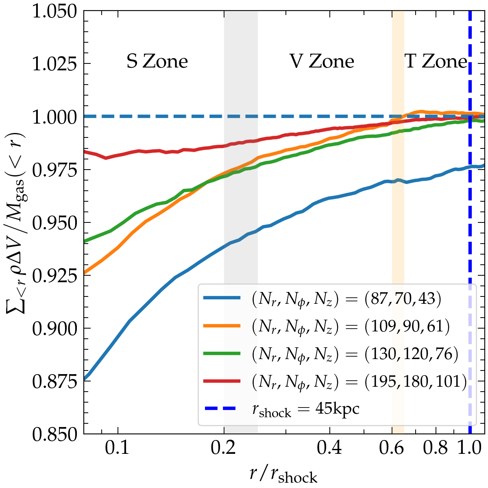
*Direct check: enclosed gas mass computed from the grid, divided by the true
enclosed mass from the simulation. Below 5% error everywhere except the
coarsest grid, below 2% at the fiducial resolution. From Lu, Mandelker et al.
2024, Fig. C2.*

The second check is the stronger one, because it does not merely re-measure
the quantity that was deposited. The gravitational potential is deposited onto
the same grid, its gradient computed, and the enclosed mass recovered from
**Gauss's law**, which relates the mass inside a closed surface to the flux of
the gravitational field through it. That number is then compared against the
directly summed mass of gas, stars and dark matter. The two routes share
almost none of their machinery, so agreement is real evidence.

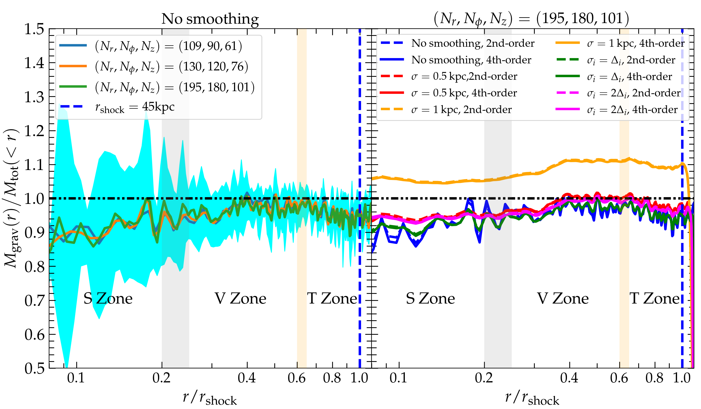
*The independent check: mass recovered via Gauss's law divided by the directly
summed mass, which should equal 1 everywhere. The method systematically
underpredicts by ~5% on average, with inner regions where there are fewer 
bins having a larger error, and outer regions having a smaller error. Three
grid resolutions agree with no systematic trend between them, which is the
convergence behaviour the discarded kernel scheme lacked (Left panel). Experimenting 
with higher-order stencils for numerical derivatives and Gaussian smoothing of the 
data after it was deposited made no noticeable difference, so long as the smoothing 
kernel wasn't too large which made the fit worse (right panel). From Lu, Mandelker
et al. 2024, Fig. C3.*

The residual ~5% bias is reported rather than tuned away, and the same test
settled the surrounding numerical choices. Integration is trapezoidal, because
a first-order rectangular rule fit Gauss's law measurably worse. Derivatives
use a fourth-order centred stencil, not because it was needed (second order
agreed with it, as the right panel above shows) but because the accuracy was
free once the machinery existed. Either way the grid is padded with extra bins
so that derivatives at the boundary are computed self-consistently, which is
why the code sets its axial limits with a `4.0*Delta_z` buffer.

In industry terms this is the whole validation pattern in one place: an
attractive method rejected on a diagnostic that worsened under refinement, a
cruder method adopted for well-posedness, and its error then bounded by an
independent route to the same quantity rather than asserted.

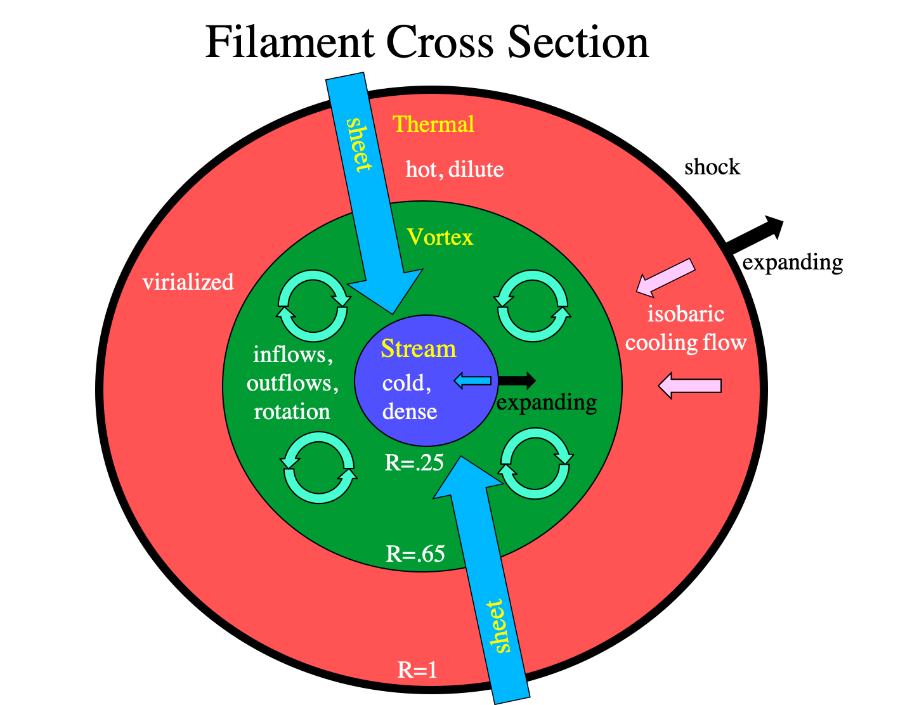
*The structural picture that came out of the force decomposition: filament
cross-sections divide into three radial zones with different dominant physics.
From Lu, Mandelker et al. 2024, Fig. 2.*

## Another result the resolution made possible

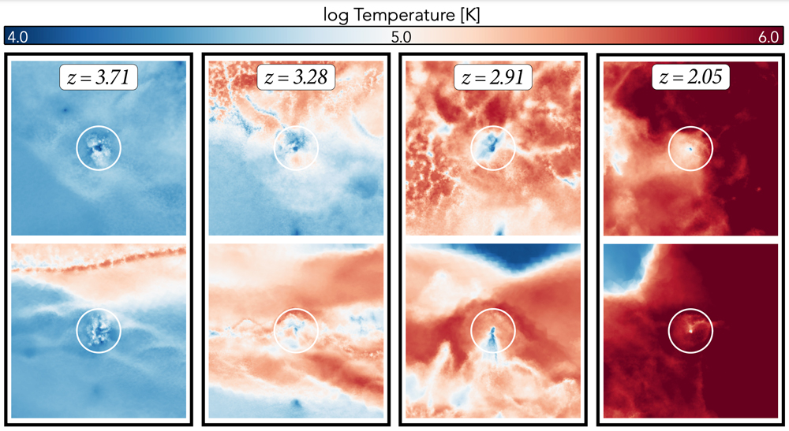
*One galaxy, four epochs, face-on (top) and edge-on (bottom) to the sheet.
Early on it sits in cold gas (blue) and holds a reservoir of its own. As the
sheet's shock reaches it, the surroundings heat to over a million degrees
(red) and the galaxy's cold gas is stripped away, leaving it unable to keep
forming stars. Nothing else happens to it: no massive neighbour, no merger, 
no explosive feedback. From Pasha, Mandelker et al. 2022, Fig. 4.*

[Pasha, Mandelker et al. 2022](https://arxiv.org/abs/2204.04097), led by a
student I supervised, used the same simulations to identify a previously
unrecognised mechanism by which small isolated galaxies stop forming stars:
shock-heating of the sheet they inhabit, with no massive neighbour involved.
The mechanism has since been confirmed by other groups using different
simulations.

## Current work

Work led by my postdoc Zhiyuan Yao, in collaboration with me and Volker
Springel, combines the two refinement methods into a single simulation suite
resolving both the cosmic web and the circumgalactic medium. Three of the six
planned simulations have been run and are being analysed; the results are not
yet published.

## A note on running this code

**These scripts cannot be run outside the AREPO collaboration.** Every one of
them begins `from gadget import *`, a snapshot-reading toolkit distributed by
invitation to AREPO users and not publicly available. The simulation
snapshots themselves are tens of terabytes and are not distributable either.
The code is included to show method and design decisions, not as a runnable
artifact.

This is research code written by a physicist to answer specific questions
under deadline. It is presented as it was written, with the parameter blocks,
commented-out alternatives, and accumulated switches that real analysis code
carries.

`analysis/sample_data/` holds the small inputs that *are* included: the tracked
positions of the two most massive halos in each snapshot, and their masses and
sizes over the same period. Each halo is identified by following its descendant
to the final snapshot rather than by taking the most massive object
independently at each time, which keeps the reference frame from jumping
between different objects as the halos grow and merge. That frame anchors the
projections, the movie, and the filament selection. One file of each kind is
included as a format example; equivalents exist for every resolution level.

## Credits

The force-decomposition code in `force_decomposition/` originated with Yue
Samuel Lu, lead author of Lu, Mandelker et al. 2024 and a student I
supervised; the files here are my edited versions, written to run the
interpolation and validation tests described above. All figures are from my
own published papers and are cited individually above.

## Contents

```
├── README.md
├── analysis/                                  ← Python analysis (M19, M21)
│   ├── Ncells_estimate.py                     ← refinement cost model: actual vs uniform-resolution cost
│   ├── gas_temperature_histories_from_nT_overdensity.py
│   │                                          ← Lagrangian cohort tracking on a moving mesh (M21 Fig. 13)
│   ├── MakeMaps_Temp_Gas.py                   ← density-weighted temperature maps in a halo-anchored frame
│   │                                            (M21 Fig. 2, and the frames of the temperature movie)
│   ├── NHI_covering_fractions_sheet_projected_metallicity_bins_convergence.py
│   │                                          ← forward model to the observable: HI covering fractions (M21 Fig. 6)
│   ├── halo_masses_and_sizes.py               ← halo properties vs time
│   └── sample_data/                           ← tracked halo positions, masses and sizes (frame anchoring)
├── force_decomposition/                       ← Lu et al. 2024 filament analysis
│   ├── deposit_to_cylindrical_grid.py         ← Voronoi mesh → cylindrical grid, with the interpolation switch
│   └── Summation_method_3_SPH_NM_edited.ipynb ← force terms, boundary integrals, Gauss's-law check
├── figures/                                   ← publication figures (my papers, cited)
└── movies/                                    ← rendered simulation movies
```
