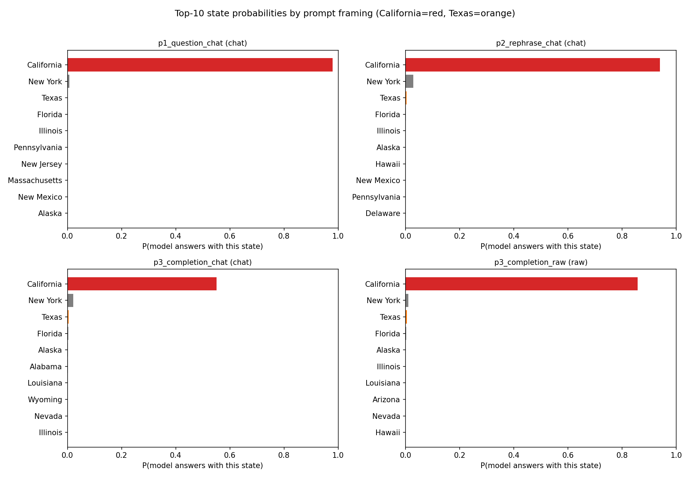
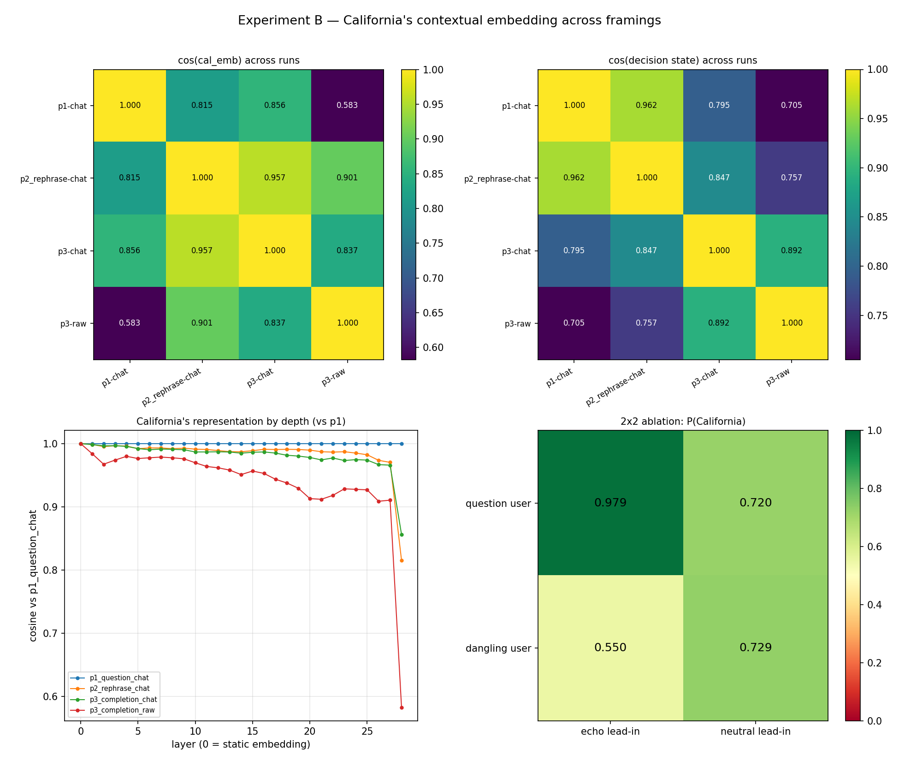
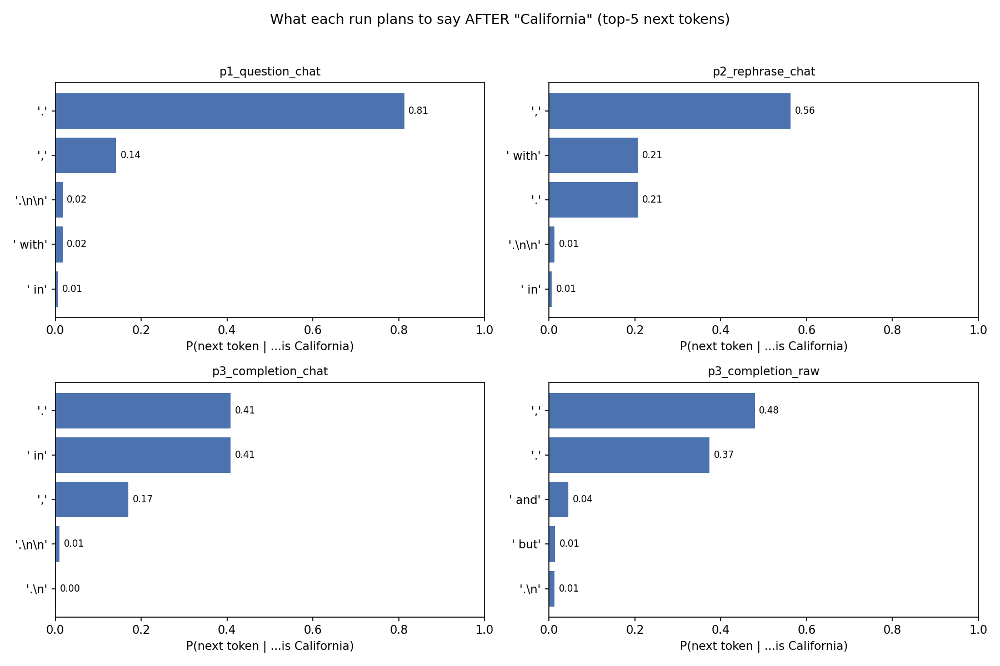
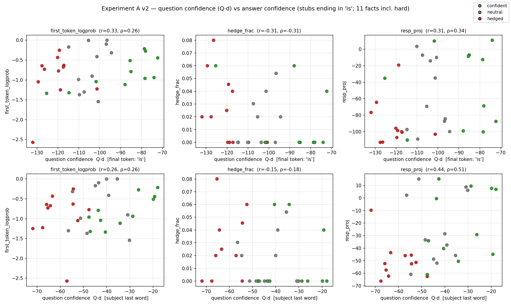

# Probing Prompt Framing in a Small Language Model

**What I built while teaching myself PyTorch and Hugging Face transformers: 
four experiments on Qwen2.5-1.5B-Instruct asking whether and how rephrasing 
a question changes what the model appears to believe, and where in the network 
that change happens.**

**Scope:** This is not research from my academic career, and it is not a 
contribution to the literature. It is the result of a few days' work reading up 
on transformer architecture, working through the PyTorch tutorials, and then 
attempting something real with what I had learned. Nothing here is a new result, 
and the techniques are standard practice in interpretability work. What the 
project is meant to demonstrate is narrower, and I think more useful: that the way 
I approach a measurement problem transfers to a domain I had just started learning. 
This was also the first time I used an AI coding assistant to help me write code. 
However, the experimental design, the choice of controls, the confound analysis, 
and the conclusions are all mine, and where the analysis is wrong or weak, that 
is mine too. This is also the only project here that anyone can run: the model 
is public and needs no authentication. These are preliminary findings, and I 
intend to keep building on them as I learn more.

## The question

Ask a model the same factual question three ways, with identical meaning, and
it should give the same answer with the same confidence. It does not.


*Probability distribution of model answers to a question about "the most populous
state", under four framings of the same question. California is ranked 1 in all
four, but the probability assigned to it ranges from 0.979 to 0.550. Measured
by scoring all 50 state names at a fixed answer slot.*

| Framing | P(California) |
|---|---|
| Direct question, chat template | **0.979** |
| Rephrased question, chat template | 0.940 |
| Raw completion of "Everyone knows the most populous state is" | 0.857 |
| That same stub fed through the chat template | **0.550** |

Two things fell out of this immediately:

- **The runner-up is New York, not Texas.** Texas is consistently rank 3 at
  ~0.0004–0.006. The model appears to conflate "most populous" with general
  prominence.
- **When confidence drops, the missing mass does not go to other states.** It
  goes to hedge and filler tokens that delay the answer: `currently` 0.096,
  `the` 0.066, `usually` 0.045, `typically` 0.040. About 41% of the answer-slot
  mass in the worst framing is non-state, against 1.3% for the direct question.
  So the model's actual confidence in California is higher than 0.550 suggests.
  Much of it is California pushed one token to the right, behind an adverb.

`scripts/prompt_compare.py`. I scored each multi-token name over its full 
continuation rather than its first token. Ten of the fifty state names are 
two tokens under this tokenizer, and they share the first. New York, New 
Jersey, New Mexico and New Hampshire all begin with the same one, so scoring 
a name by its first token alone would have merged those four into a single 
number, which would have invalidated the runner-up result mentioned above. 

## Same concept, or different?

A confidence drop could mean two very different things. Either the model's
internal representation of California has changed, or the representation is
intact and something late in the network is hedging on the way out. These have
different implications, and the probabilities alone cannot distinguish them.


***Top:** cosine similarity between framings of California's contextual
embedding and of the "decision state" that predicts the answer. **Bottom left:** 
similarity to the direct-question run layer by layer. The curves sit above 0.97 
through roughly layer 26 of 28, then fall sharply at the final layer only. 
**Bottom right:** the 2x2 ablation isolating the cause.*

**The representation is essentially framing-invariant, and divergence is
concentrated in the final layer.** The model knows California just as well in
all four framings, but the output-facing machinery is different. The confidence
collapse is due to hedging, not a changed belief. This holds cleanly among the 
three runs that share the chat format. The raw completion's apparent divergence 
is an artifact of its different format, not a finding about the model.

One caution about reading these numbers, which I got wrong at first. I took the 
cosines as a confidence signal, and they are not one. The raw completion is the 
most representationally distant from the direct question (cosine 0.583) yet stays 
fairly confident at 0.857, while the chat-template stub sits much closer (0.856) 
and is the least confident of the four at 0.550. Activation distance and output 
probability measure different things. This was obvious in hindsight, and well known 
to any expert in the field, but it took the contradiction in my own numbers to make 
me realize it. Two rules followed: compare activations only between runs that share 
a prompt format, and read confidence off the logit rather than the cosine.

The 2×2 ablation isolates what triggers the hedging. Potential explanations 
included whether the user turn is a real question or a dangling fragment, and 
whether the assistant turn echoes the user's phrasing or uses a neutral lead-in. 

|  | echo lead-in | neutral lead-in |
|---|---|---|
| **question user turn** | 0.979 | 0.720 |
| **dangling user turn** | **0.550** | 0.729 |

The echo lead-in is not damaging in itself. Paired with a real question it gives the
highest confidence of all. It is the *combination* of an echo with a dangling
user fragment that collapses it, producing a structure where the assistant
appears to be parroting an unfinished sentence back at the user. Swap in a
neutral lead-in and the dangling framing recovers to 0.729. Basically, this 
is an out-of-distribution conversational shape, not a fact-confidence effect.


*What the answer-position activation actually encodes. The top-5 next tokens 
after "...is California" differ sharply by framing. The direct question 
terminates (`.` 0.81); the rephrase elaborates (`,` 0.56); the chat-template 
stub is split (`.` and `in` both 0.41). All four are equally sure it is 
California, but they differ in how they plan to package it.*

## Does a confident question produce a confident answer?

The obvious follow-up: if framing shifts expressed confidence on one fact, does
question confidence predict answer confidence in general? I built a unit
"confidence direction" `d` as the mean activation of confidently-framed
questions minus that of hedged ones, and correlated each question's projection
onto `d` against three measures of answer confidence. The direction is rebuilt
for every fact from the other facts only, so that no prompt helps define the
direction it is then scored against.

My first version gave an encouraging r = 0.62, but its prompts were confounded:
the confident and hedged stubs ended on different words, so the measure was
reading sentence structure as much as framing. I rebuilt them to be identical
apart from the framing itself. A second problem was simpler, and is visible in
the figure below as `hedge_frac`: the hedge words lived in the prompt, not in
the response, so that measure was reading nothing at all.


*Version 2, de-confounded: all prompts are stubs ending in "is", 11 facts
including 5 genuinely hard ones. Colour represents the framing tier, namely 
confident, neutral, or hedged, as indicated in the legend. The tiers do separate
along the x-axis, but the correlations are weak (r ≈ 0.26–0.44 depending on
measure and definition).*

**The de-confounded effect is weaker than the confounded one.** Every
correlation is in the hypothesized direction, and every one is around 0.3. The
honest conclusion is that prompt-confidence framing has at most a weak effect
on expressed answer confidence in this model, and that v1's stronger result was
an artifact of my own prompt construction.

**The interesting result turned out to be qualitative, and it inverts the naive
hypothesis.** On the hard facts, confident framing ("Everyone knows that...")
produced short, confidently *wrong* answers: the largest asteroid-belt object
came back as "J1407b", an exoplanet; the heaviest element from Big Bang
nucleosynthesis came back as "iron-56". You can probably see my astrophysics 
background seeping into the choice of hard facts. Hedged framing ("I'm not sure, but I
think that...") produced deliberation, "To determine this we need to
consider...", and for the asteroid question the correct answer, Ceres. Inviting
uncertainty induced reasoning; asserting certainty induced guessing. This is
consistent with well-known results from the chain-of-thought literature, which 
show that inviting a model to reason improves its accuracy. This result suggests 
that asserting certainty suppresses reasoning it would otherwise have done.

## What I would do next

Some obvious next steps, to continue teaching myself this domain and to make 
these results more robust.

- **My sample size is small.** Eleven facts and four framings is enough to see 
  an effect and not enough to size it. The qualitative hard-fact result in 
  particular is an observation, not a measurement.
- **The hedge-fraction measure is still confounded by response length.**
  Confident answers are terse, so they score near-zero hedging trivially.
- **I only experimented with one model, of one size.** Whether the final-layer 
  localisation holds at larger scale is the obvious next question, and the 
  experiment would transfer directly.
- **One of the three answer-confidence measures is not independent of the
  question.** The projection of the response activation onto `d` gives the 
  strongest correlation, but a response is generated in the same forward pass 
  as its own question, so its activation inherits part of the question's whether 
  or not framing genuinely propagates. That measure supports the other two rather 
  than standing as separate evidence.

## Running it

```bash
pip install -r requirements.txt
python scripts/prompt_compare.py          # framings -> answer probabilities
python scripts/california_activation.py   # layer-wise activations + 2x2 ablation
python scripts/california_continuation.py # next-token probe (reuses saved activations)
python scripts/qa_confidence_v2.py        # confidence direction, de-confounded
```

`Qwen/Qwen2.5-1.5B-Instruct` (~3 GB) downloads on first run and needs no
Hugging Face authentication. Everything runs on a single GPU; the scripts fall
back to CPU, slowly. Outputs land in `results/` and `figures/`.

## Contents

```
├── README.md
├── scripts/
│   ├── prompt_compare.py            ← 50-state answer probabilities under 4 framings
│   ├── california_activation.py     ← layer-wise activation similarity + 2x2 ablation
│   ├── california_continuation.py   ← what the answer-position activation encodes
│   └── qa_confidence_v2.py          ← confidence direction, after de-confounding v1
├── figures/                         ← generated by the scripts above
├── results/                         ← raw numbers behind every figure (JSON)
└── requirements.txt
```
